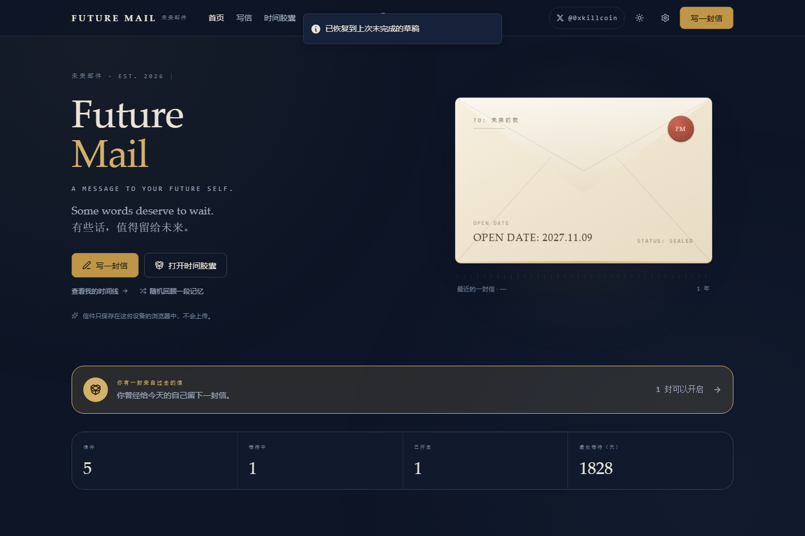
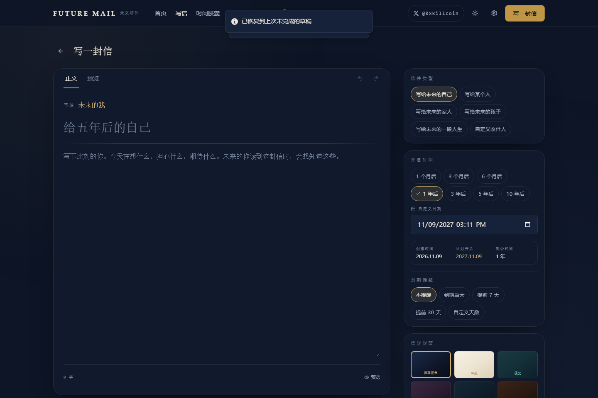
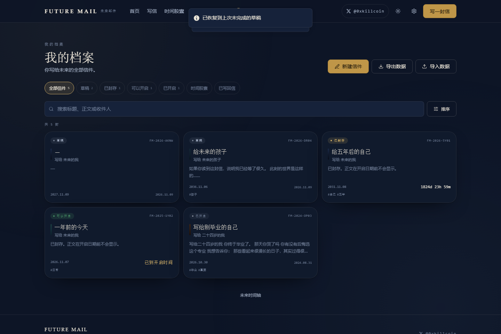
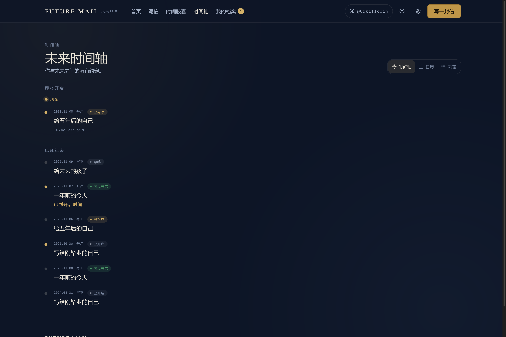
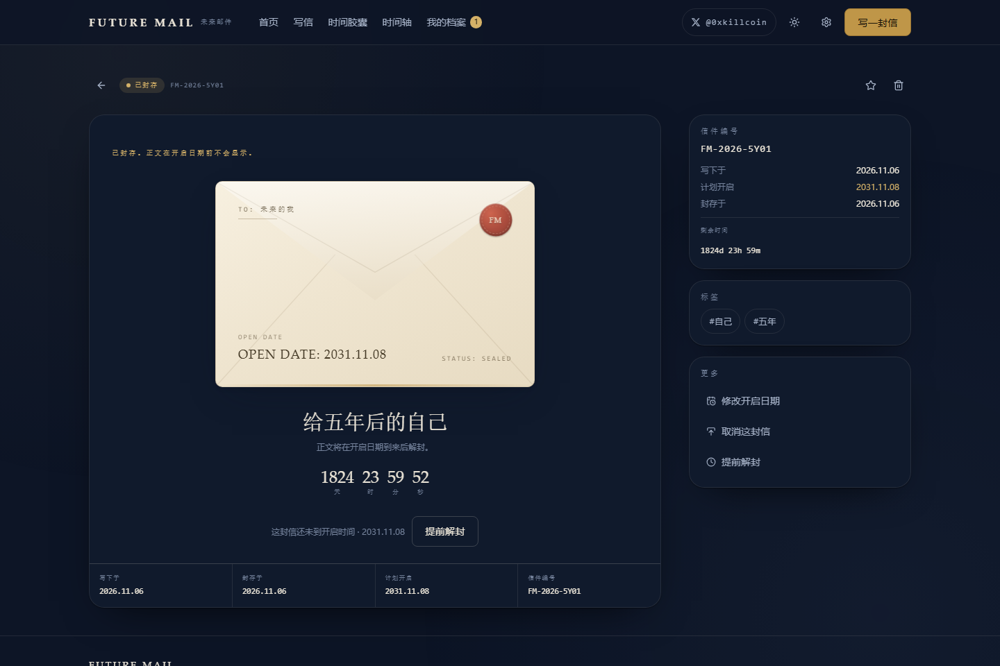
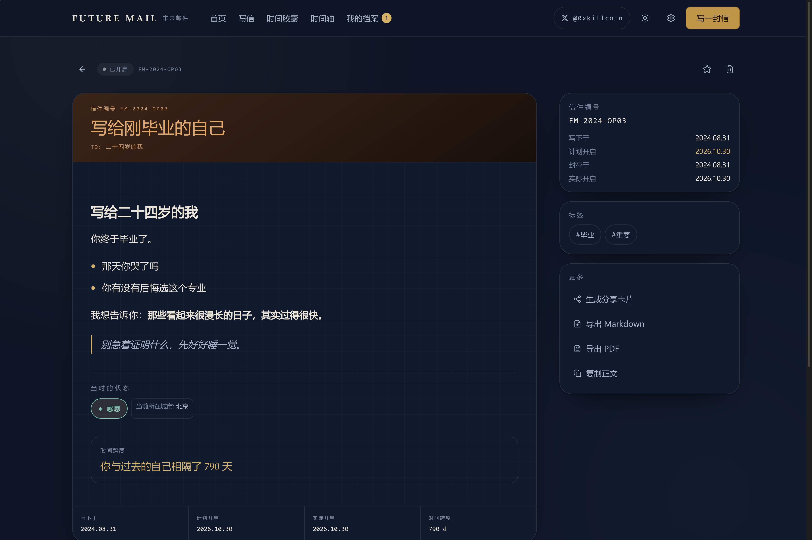
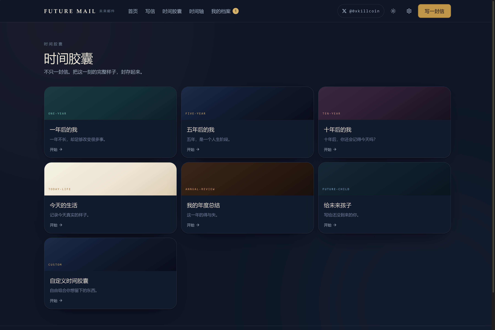
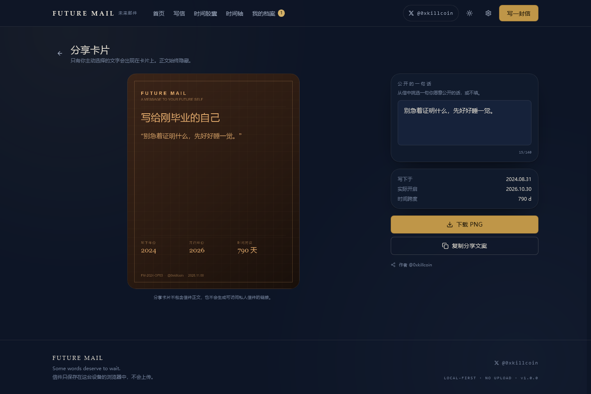
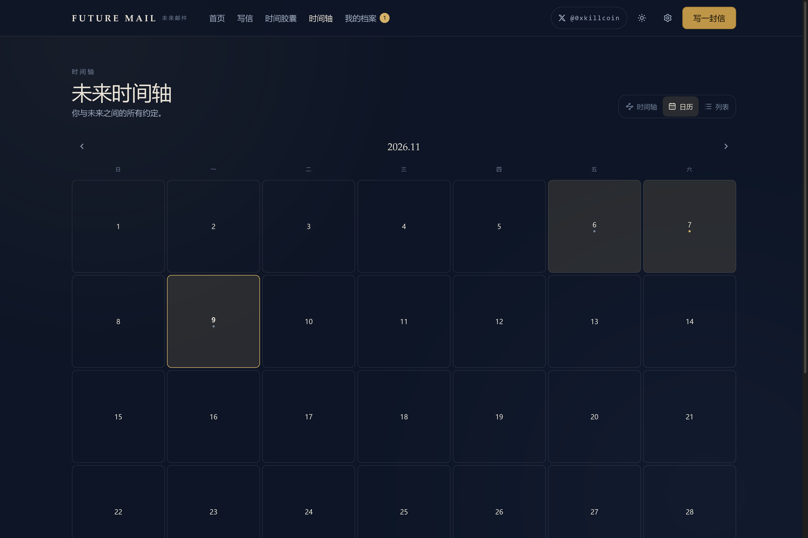
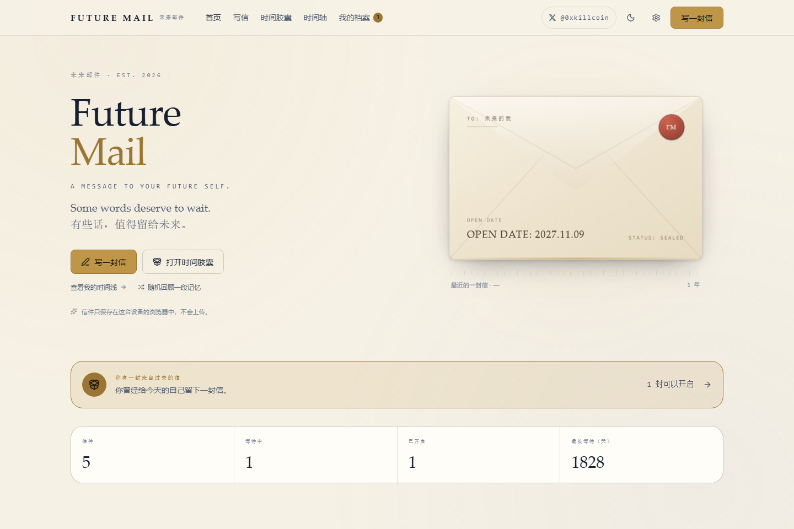

# Future Mail · 未来邮件

> **A MESSAGE TO YOUR FUTURE SELF.**
> Some words deserve to wait. · 有些话，值得留给未来。

**English** · [中文](README.zh-CN.md)

[](https://github.com/iiiiiiiiiiiiiKK/future-mail/actions/workflows/ci.yml)
[](LICENSE)
[](https://react.dev)
[](#data-storage)
[](#privacy)

Author on X — **[𝕏 @0xkillcoin](https://x.com/0xkillcoin)**

### ▶ Live demo · [iiiiiiiiiiiiikk.github.io/future-mail](https://iiiiiiiiiiiiikk.github.io/future-mail/)

**No sign-up, no install.** Open it and write — everything stays in your browser.

---

## What is this?

**Future Mail is a time capsule for words.**

You write a letter today, choose a date in the future, and seal it. The letter
becomes unreadable — not hidden by CSS, but genuinely unsealed only when the date
arrives. When that day comes, your past self speaks to you again.

It is not an email client. It is not a todo app. It is a small ritual machine for
the one thing the internet is worst at: **slowing down**.

```
write  →  choose a date  →  seal  →  wait  →  unseal  →  remember
```

---

## Screenshots

| Home — envelope sealed for five years | Write a letter |
| --- | --- |
|  |  |

| My archive | Future timeline |
| --- | --- |
|  |  |

| Sealed letter (body hidden) | Opened letter |
| --- | --- |
|  |  |

| Time capsule templates | Share card (PNG) |
| --- | --- |
|  |  |

| Calendar view | Light theme |
| --- | --- |
|  |  |

| Mobile home | Mobile compose |
| --- | --- |
|  |  |

All screenshots come from the real running build (`e2e/screenshots.spec.ts`),
not from mockups.

---

## Features

### Sealing & time

- **Real calendar maths.** `+5 years` is computed with `setMonth`/`setDate` and
  month-end clamping — `2024-02-29 + 1 year → 2025-02-28`, never "1825 days".
- **Leap years, time zones and DST** handled by working with `Date` objects and
  local-time conversions; the countdown ticks in real time.
- **Quick offsets** (1m / 3m / 6m / 1y / 3y / 5y / 10y) plus a custom
  `datetime-local` picker that refuses any past date.
- **Status machine** enforced in the data layer:
  `DRAFT → SEALED → READY → OPENED`, with `→ CANCELLED` from any unopened state.
  Illegal transitions throw instead of silently continuing.
- **Early unseal** exists, but only behind an explicit second confirmation that
  tells you it breaks the promise you made to the future.
- **Reschedule** is possible while sealed — you may move the date, not rewrite
  the letter.

### Writing

- Distraction-free serif editor with basic Markdown, live word count (CJK
  characters + Latin words), preview tab, undo/redo, and **auto-save** with a
  visible save state.
- Six letter types (future self, someone, family, future child, life chapter,
  custom recipient), six envelope cover themes, tags, and a mood snapshot.
- After sealing, the body becomes read-only — enforced in the service layer, not
  merely by hiding the textarea.

### Reminders

- Per-letter reminder window: off, on the day, 7 days, 30 days, or a **custom
  number of days** (1–3650).
- A sealed letter that enters its reminder window appears on the home page as an
  **in-app reminder** with the remaining days and the open date. This needs no
  permission and works every time the site is opened.
- Browser notifications are opt-in, separately, in Settings — and the UI states
  plainly that they cannot be guaranteed once the site is closed.

### Time capsules

Full multimedia capsules with seven templates (1 year, 5 years, 10 years, today's
life, year in review, future child, custom). Each template offers different
prompts; **every field is optional** — one sentence is a complete capsule.
Supports photos, audio, PDF and text attachments plus external video links.

### Timeline

Three views over the same data: a vertical **timeline** (past / now marker /
upcoming), a **calendar** that marks days on which something was written or will
open, and a compact **list**.

### Opening & replying

- Due letters flip to `READY` automatically when the app loads.
- Opening shows title, original creation date, planned date, actual open date,
  the body, attachments, and the **real** day span
  ("1828 days between you and your past self").
- **Reply to your past self** with a *new* open date — forming a chain of letters
  through time. Replies are linked in both directions.
- Review notes, starring, Markdown export, PDF export, and a share card.

### Share card

A 1080×1350 PNG rendered on canvas. **The letter body never appears on it.**
Only the title, years, day span, and a single sentence *you explicitly choose*
to make public. No link to the private letter is ever generated.

### Data ownership

- Full JSON backup (with attachments inlined as base64) and restore.
- Import is strict: format check, version check, field normalisation, duplicate
  ID detection, and per-item reporting. **It never silently overwrites.**
- Markdown + PDF export per letter.
- One-click "delete all local data" behind a confirmation that states the count.

### Interface

- Bilingual (中文 / English) — switchable at runtime, persisted.
- Dark and light themes, plus follow-system.
- Responsive from 390 px phones to wide desktops; separate mobile bottom
  navigation, safe-area padding, and no hover-only affordances.
- `prefers-reduced-motion` respected: animations collapse to near-zero.

---

## Quick start

```bash
git clone https://github.com/iiiiiiiiiiiiiKK/future-mail.git
cd future-mail
npm install
npm run dev          # http://localhost:5173
```

No backend, no API key, no database required. Open the page and start writing.

### All scripts

| Command | What it does |
| --- | --- |
| `npm run dev` | Vite dev server with HMR |
| `npm run build` | `tsc` typecheck + production build into `dist/` |
| `npm run preview` | Serve the production build locally |
| `npm run typecheck` | TypeScript only, no emit |
| `npm run lint` | ESLint (flat config, type-aware rules for hooks) |
| `npm test` | Vitest unit + integration tests (85 tests) |
| `npm run test:watch` | Vitest in watch mode |
| `npm run test:e2e` | Playwright end-to-end tests (desktop + iPhone 13) |
| `npm run test:e2e:prod` | Acceptance tests against the deployed URL |
| `npm run screenshots` | Regenerate `docs/screenshots/` from the real build |

---

## Tech stack

| Layer | Choice | Why |
| --- | --- | --- |
| UI | React 19 + TypeScript | Strict types across the whole data model |
| Build | Vite | Fast dev, `base: './'` for portable static hosting |
| Styling | Tailwind CSS v4 + CSS custom properties | Design tokens drive light/dark without class soup |
| State | Zustand | Tiny, no provider tree, easy to keep DB ↔ memory consistent |
| Storage | Dexie (IndexedDB) | Real transactional storage for letters **and** binary blobs |
| Dates | date-fns + native `Date` | Calendar-accurate arithmetic, no "fixed days" shortcuts |
| Routing | React Router (`HashRouter`) | Works on GitHub Pages with zero server rewrite rules |
| PDF | jsPDF | Client-side PDF with CJK-safe canvas rendering |
| Tests | Vitest + fake-indexeddb + Playwright | Domain logic, real IndexedDB, real browser |

### Architecture

```
src/
  app/                 routing shell (App.tsx)
  components/          Envelope, Countdown, StatusBadge, ConfirmDialog, Markdown…
  features/
    home/              landing + envelope hero
    compose/           editor, schedule picker, cover themes, mood
    capsule/           capsule templates + multi-field capture
    timeline/          timeline / calendar / list views
    archive/           search, filter, sort, bulk actions
    letters/           sealed view, reveal, reply, export
    attachments/       IndexedDB blob manager + viewer
    sharing/           canvas share card
    settings/          theme, language, notifications, data
  services/
    storage/           db.ts (Dexie schema), letters.ts (state machine, CRUD)
    attachments/       type/size validation, blob I/O
    export/            JSON / Markdown / PDF
    import/            strict validation + migration
    notifications/     in-app + browser notifications (explicit limits)
    email/             reserved provider interface (currently not-configured)
  stores/              Zustand app store
  hooks/               useAutoSave, useUndoableText, useNow
  types/               single source of truth for the data model
  i18n/                zh/en dictionaries + interpolation
  utils/               date maths, formatting, helpers
```

Design rules that are actually enforced:

- **No fake success.** If IndexedDB is unavailable (private mode, quota), a guard
  screen explains it instead of pretending the letter was saved.
- **No hidden encryption claims.** The app does not claim end-to-end encryption;
  it claims local-only storage and enforces read-only-after-seal in the service
  layer.
- **No network calls at runtime.** Fonts are system fonts, icons are inline SVG,
  nothing is uploaded.

---

## Data storage

Everything lives in **IndexedDB** in your browser, under the database
`future-mail`, with four object stores:

| Store | Contents |
| --- | --- |
| `letters` | letter records, indexed by status / dates / tags / reply relations |
| `blobs` | attachment binaries (images, audio, PDF, text) |
| `settings` | language, theme, notification preference |
| `meta` | data schema version (for future migrations) |

**There is no cloud sync.** Switching devices, clearing site data, or using
private browsing will lose letters. Export a JSON backup regularly
(Settings → Export everything).

Storage labels on the Settings page are read from
`navigator.storage.estimate()`, so you see the real quota your browser grants.

---

## Privacy

1. **Private by default.** Every letter is `privacy: 'private'`.
2. **Nothing is uploaded.** No analytics, no telemetry, no fonts CDN, no AI
   training, no third-party requests at runtime.
3. **Letter bodies never enter logs.**
4. **Share cards are opt-in.** Only the sentence you select is rendered.
5. **Delete means delete.** "Delete all local data" clears letters, blobs,
   settings and meta in a single transaction.

---

## Data backup & restore

- **Export everything (JSON)** — letters + attachments base64 inlined.
- **Export letters only (JSON)** — metadata and text, no binaries.
- **Import (JSON)** — validated and normalised; existing IDs are **skipped**, not
  overwritten. The result reports `imported / skipped / duplicated / invalid`.
- **Per-letter export** — Markdown and PDF.
- **Schema versioning** — exports carry `version`; import refuses files newer
  than the app supports instead of corrupting data.

---

## Email delivery (not implemented by design)

This version **does not send any email.**

The interface exists (`src/services/email/email.ts`) but the default provider
returns `not-configured`, and the UI states this plainly. No "sent" toast is ever
shown for a message that was not sent.

Reliable scheduled email **cannot** be done from front-end JavaScript — it needs
a server-side scheduler. If you want to add it:

1. Deploy a small Worker with a Cron Trigger (Cloudflare Workers, for example).
2. Store only `{ letterId, recipientEmail, scheduledOpenAt, sentAt }` — never the
   letter body.
3. Use an idempotency key per letter per date so a repeated Cron run cannot send
   twice.
4. Send the notification with a link the recipient opens in *their own* browser,
   and keep the body client-side.

`VITE_SCHEDULER_ENDPOINT` and `VITE_EMAIL_PROVIDER` are reserved in
`.env.example`. Never put server secrets in `VITE_*` variables — they ship to the
client.

---

## Deployment

The app is a static SPA with `base: './'` and `HashRouter`, so it runs on any
static host with **no rewrite rules**.

**Current status:** deployed to GitHub Pages and verified in production —
<https://iiiiiiiiiiiiikk.github.io/future-mail/> (16 production acceptance tests
passing against the live URL, see `e2e/production.spec.ts`).

### GitHub Pages (automatic)

`.github/workflows/ci.yml` runs typecheck → lint → unit tests → build → E2E, then
publishes `dist/` to Pages on every push to `main`.

One-time setup: **Settings → Pages → Source: GitHub Actions**.

### Cloudflare Pages

| Setting | Value |
| --- | --- |
| Build command | `npm run build` |
| Output directory | `dist` |
| Node version | 22 |

### Vercel

Framework preset **Vite**, build `npm run build`, output `dist`.

### Any static server

```bash
npm run build
# upload the contents of dist/ — that is the entire product
```

---

## Testing

```
Unit + integration (Vitest, fake-indexeddb)      85 passed
  ├─ utils/date.test.ts              23  calendar maths, leap years, DST, offsets
  ├─ services/storage/letters.test.ts 26  state machine, seal, due, open, reply chain
  ├─ services/import/import.test.ts   13  strict validation, dedupe, no overwrite
  ├─ services/attachments.test.ts      8  type/size validation, blob lifecycle
  ├─ utils/misc.test.ts               11  formatting, i18n, email-not-configured
  └─ services/storage/blobs.test.ts    4  base64 <-> ArrayBuffer, persisted bytes

End-to-end, local build (Playwright, real browser + real IndexedDB)   58 passed
  desktop-chromium (1440×900)       29 passed
  mobile-safari (iPhone 13)         29 passed

End-to-end, live deployment (github.io production URL)               18 passed
  prod-desktop                       9 passed
  prod-mobile (iPhone 13)            9 passed
```

E2E covers: X author link on desktop **and** in the mobile menu, compose →
auto-save → seal → archive, past-date rejection, draft resumption, capsule
creation, due-letter open (body hidden before, visible after), early-unseal
confirmation, reply creation, share card PNG download **with the body asserted
absent**, JSON export → wipe → import round-trip, theme + language switching with
reload persistence, the local-storage privacy notice, attachment upload that
really lands in IndexedDB, real Markdown/PDF downloads, and the reminder window
(in-window letters appear, out-of-window and disabled ones do not, custom day
counts persist).

`e2e/mobile-audit.spec.ts` adds an automated mobile audit on a 390×844 viewport:
zero horizontal overflow on every route, minimum touch-target sizes, no bottom-nav
occlusion of the primary action, long title/recipient stress test, and iOS
safe-area support.

```bash
npm run typecheck && npm run lint && npm test && npm run build
npm run test:e2e          # local build
npm run test:e2e:prod     # against the deployed site
```

---

## Known limitations

| Limitation | Why | Mitigation |
| --- | --- | --- |
| No cloud sync | Local-first by design; no account system | JSON backup / restore |
| Data lost on clearing browser data | IndexedDB is per-origin and per-device | Export regularly; the UI says so |
| No real email delivery | Requires a server-side scheduler | Reserved interface + documented integration path |
| Browser notifications unreliable when the site is closed | Web Notifications have no background delivery | In-app due banner always works when the site opens |
| Unencrypted at rest | No key management story; claiming E2EE would be dishonest | Stated plainly in UI and here |
| PDF uses canvas rendering for CJK | Avoids shipping multi-MB font files (bundle stays ~320 KB gzip) | Text remains selectable in Markdown export |
| Attachments limited to 8 MB / 10 files | IndexedDB quota is not guaranteed | Explicit error messages, not silent failures |
| Large single JS chunk | jsPDF is lazy-imported but the main chunk is ~320 KB gzip | Acceptable for a static app; can be split further |

---

## Roadmap

- [ ] Optional encrypted vault (passphrase-derived key, WebCrypto, documented limits)
- [ ] Cloudflare Worker + Cron + Resend for opt-in email delivery
- [ ] Web Share API for the share card on mobile
- [ ] Calendar export (`.ics`) for upcoming unsealings
- [ ] Print stylesheet for a true "paper letter" view

---

## Contributing

Issues and pull requests are welcome.

```bash
npm install
npm run typecheck && npm run lint && npm test
npm run dev
```

Please keep the invariants: no fake success states, no unlabelled `TODO`s, no
claims in docs that the code does not back up, and no runtime network calls.

---

## License

[MIT](LICENSE) © 2026 Future Mail · [@0xkillcoin](https://x.com/0xkillcoin)

---

<p align="center">
  <em>今天的你，给未来的你留一封信。</em><br/>
  <em>Today you, leave a letter for the you of tomorrow.</em>
</p>
