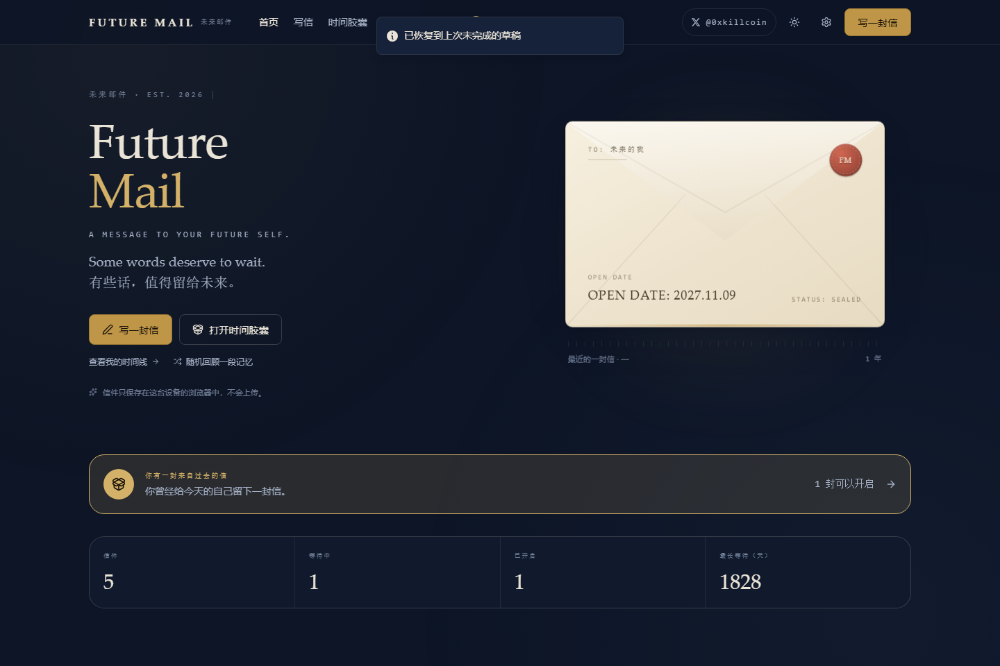
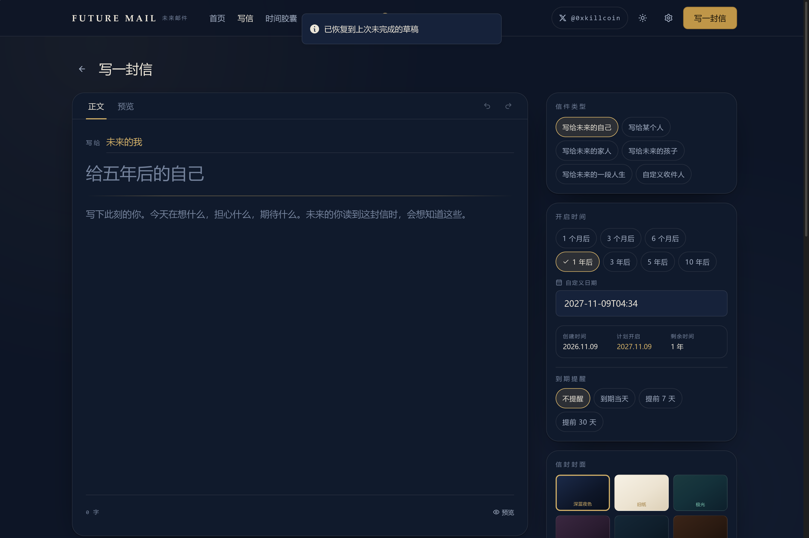
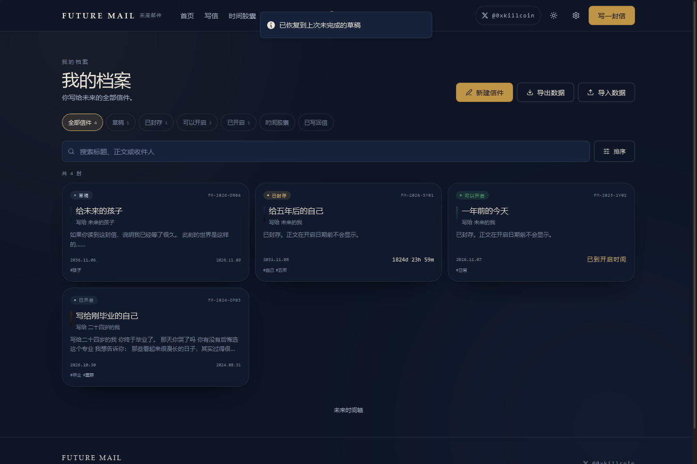
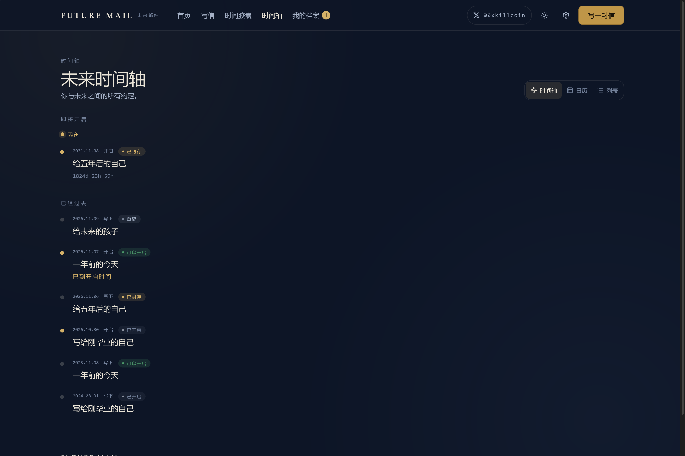
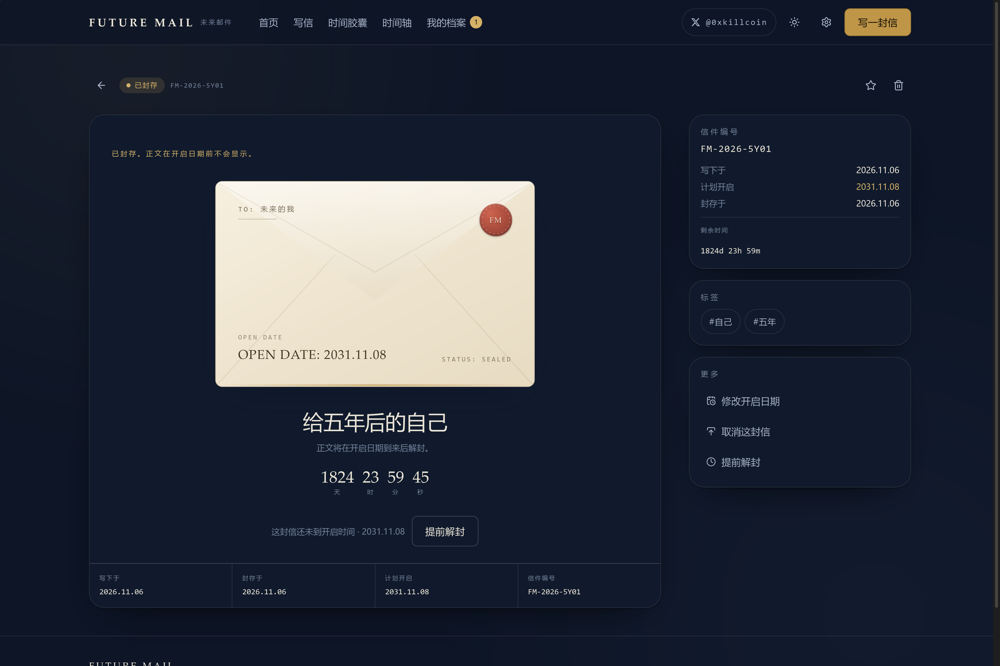
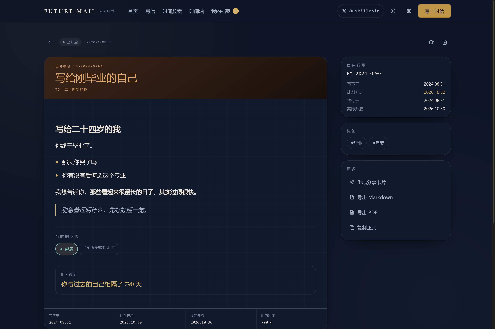
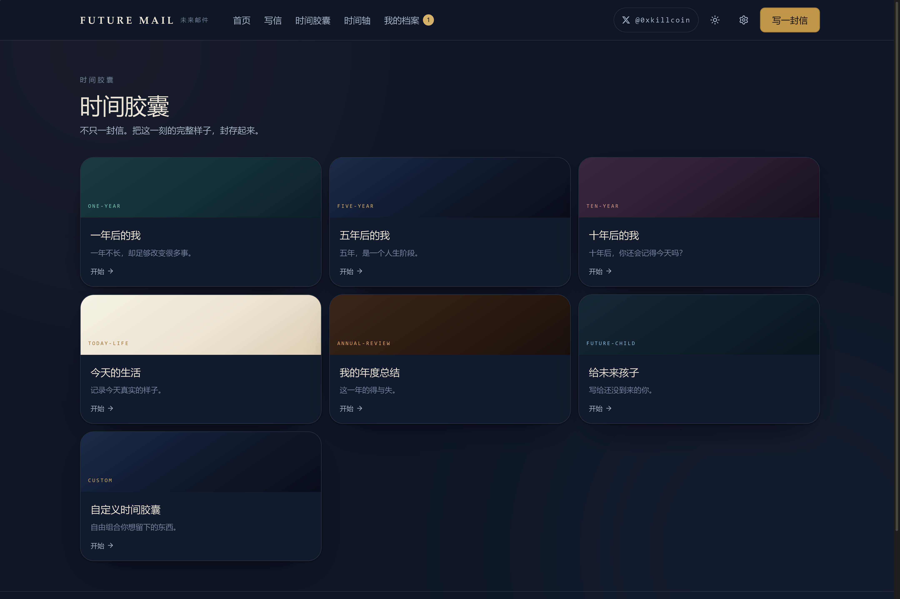
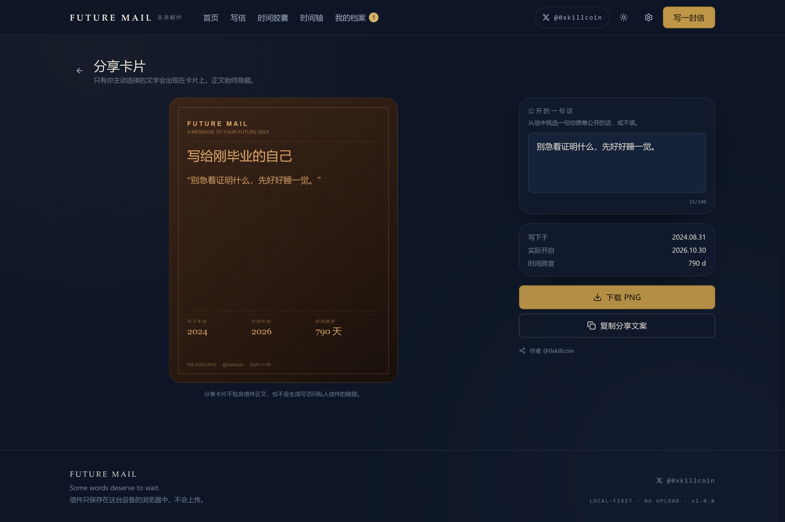
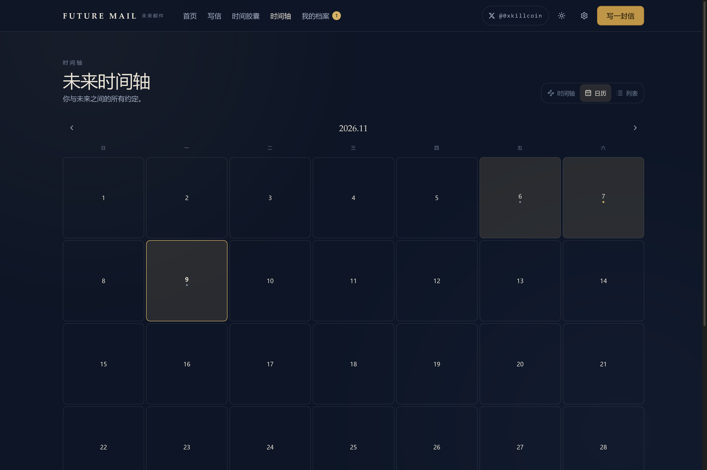
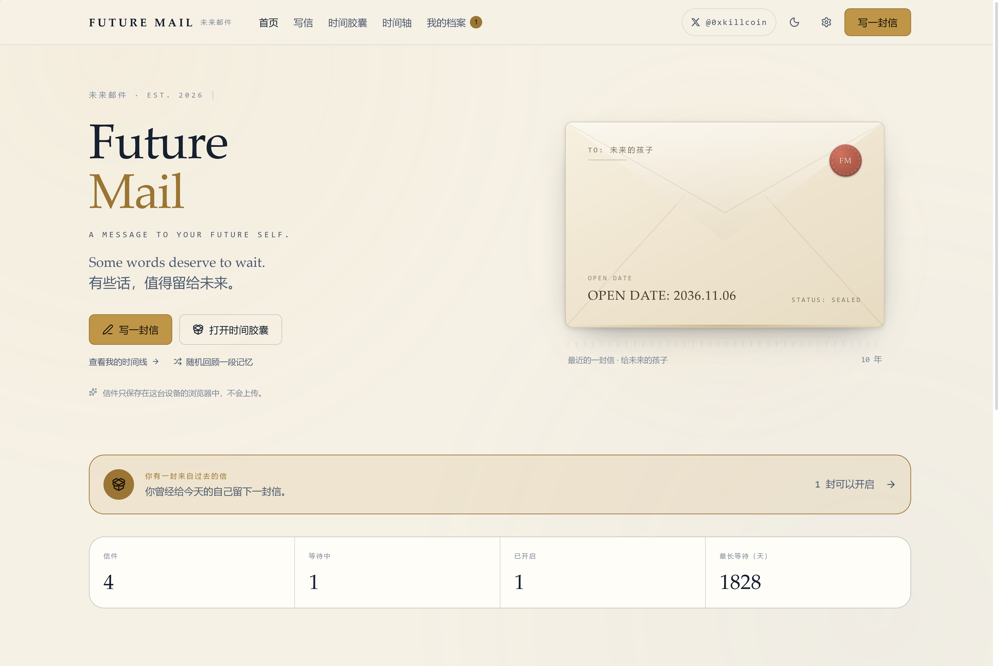

# Future Mail · 未来邮件

> **A MESSAGE TO YOUR FUTURE SELF.**
> 有些话，值得留给未来。

[English](README.md) · **中文**

[](https://github.com/iiiiiiiiiiiiiKK/future-mail/actions/workflows/ci.yml)
[](LICENSE)
[](https://react.dev)
[](#数据存储)
[](#隐私)

作者 X — **[𝕏 @0xkillcoin](https://x.com/0xkillcoin)**

### ▶ 在线体验 · [iiiiiiiiiiiiikk.github.io/future-mail](https://iiiiiiiiiiiiikk.github.io/future-mail/)

**无需注册、无需安装。** 打开就能写，数据只留在你的浏览器里。

---

## 这是什么

**Future Mail 是一台写给未来的时间胶囊。**

今天写下一封信，指定未来某一天开启，然后封存。它不是把正文用 CSS 藏起来——
在开启日期到来之前，正文在逻辑上就是不可读的；只有那天到了，它才真正解封。

它不是邮箱，也不是待办事项。它是一台很小的仪式机器，用来对付互联网最不擅长的一件事：
**慢下来。**

```
写信  →  选择日期  →  封存  →  等待  →  解封  →  回顾
```

---

## 产品截图

| 首页 · 封印中的信封 | 写信 |
| --- | --- |
|  |  |

| 我的档案 | 未来时间轴 |
| --- | --- |
|  |  |

| 已封存（正文不可见） | 已开启 |
| --- | --- |
|  |  |

| 时间胶囊模板 | 分享卡片（PNG） |
| --- | --- |
|  |  |

| 日历视图 | 浅色主题 |
| --- | --- |
|  |  |

| 移动端首页 | 移动端写信 |
| --- | --- |
|  |  |

所有截图都来自**真实运行的生产构建**（由 `e2e/screenshots.spec.ts` 自动生成），
不是设计稿。

---

## 功能

### 封存与时间

- **真实日历运算。** `+5 年` 由 `setMonth` / `setDate` 与月末夹取计算得出：
  `2024-02-29 + 1 年 → 2025-02-28`，而不是「1825 天」这种近似。
- **闰年、时区、夏令时**全部按真实日期处理，倒计时逐秒刷新。
- **快捷选项**（1 个月 / 3 个月 / 6 个月 / 1 年 / 3 年 / 5 年 / 10 年）加上自定义
  `datetime-local`，任何过去时间都会被拒绝。
- **状态机在数据层强制执行**：
  `DRAFT → SEALED → READY → OPENED`，任意未开启状态可 `→ CANCELLED`。
  非法转换直接抛错，而不是悄悄放过。
- **提前解封**存在，但必须经过明确的二次确认，并告知这会破坏你与未来之间的约定。
- **改期**允许——你可以推迟开启，但不能改写正文。

### 写作

- 专注的衬线字体编辑器，支持基础 Markdown、实时字数（中文字 + 英文词）、预览切换、
  撤销/重做，以及**自动保存**（保存状态可见）。
- 六种信件类型（写给未来的自己 / 某个人 / 家人 / 未来的孩子 / 一段人生 / 自定义），
  六种信封封面，标签，以及心情快照。
- 封存后正文变为只读——这是服务层强制的，不是单纯隐藏输入框。

### 时间胶囊

七种模板（一年后的我 / 五年 / 十年 / 今天的生活 / 年度总结 / 未来的孩子 / 自定义），
每个模板给出不同的引导问题；**所有字段都是可选的**，只写一句也是一份完整的胶囊。
支持图片、音频、PDF、文本附件，以及外部视频链接。

### 时间轴

同一份数据三种看法：竖向**时间轴**（过去 / 现在标记 / 即将开启）、
标记了写入日与开启日的**日历**、以及紧凑的**列表**。

### 开启与回信

- 到期信件在应用加载时自动转为 `READY`。
- 开启后展示标题、原始创建日期、计划开启日、实际开启日、正文、附件，以及**真实的**
  天数跨度（「你与过去的自己相隔了 1828 天」）。
- **给过去的自己写回信**，并设置新的开启日期——形成一条穿越时间的通信链，双向关联。
- 回顾笔记、标记重要、Markdown 导出、PDF 导出、分享卡片。

### 分享卡片

Canvas 渲染的 1080×1350 PNG。**正文永远不会出现在卡片上。**
只有标题、年份、天数跨度，以及你**主动挑选**的一句公开文字。
不会生成任何可以访问私人信件的链接。

### 数据所有权

- 完整 JSON 备份（附件以 base64 内联）与恢复。
- 导入是严格的：格式检查、版本检查、字段规范化、重复 ID 检测、逐条结果报告，
  **绝不静默覆盖**。
- 单封导出 Markdown 与 PDF。
- 「删除全部本地数据」需确认，并明确告知将被删除的信件数量。

### 界面

- 中英文双语，运行时可切换并持久化。
- 深浅色主题，可跟随系统。
- 从 390px 手机到宽屏桌面全程自适应；移动端独立底部导航、安全区内边距、
  不存在「只能 hover 才能发现」的交互。
- 尊重 `prefers-reduced-motion`：动效近乎归零。

---

## 快速开始

```bash
git clone https://github.com/iiiiiiiiiiiiiKK/future-mail.git
cd future-mail
npm install
npm run dev          # http://localhost:5173
```

无需后端、无需 API Key、无需数据库。打开就能写。

### 全部脚本

| 命令 | 作用 |
| --- | --- |
| `npm run dev` | Vite 开发服务器（HMR） |
| `npm run build` | `tsc` 类型检查 + 生产构建到 `dist/` |
| `npm run preview` | 本地预览生产构建 |
| `npm run typecheck` | 仅 TypeScript 检查 |
| `npm run lint` | ESLint（flat config，含 hooks 规则） |
| `npm test` | Vitest 单元 + 集成测试（81 个） |
| `npm run test:watch` | Vitest 监听模式 |
| `npm run test:e2e` | Playwright 端到端测试（桌面 + iPhone 13） |

---

## 技术架构

| 层 | 选择 | 理由 |
| --- | --- | --- |
| UI | React 19 + TypeScript | 全数据模型严格类型 |
| 构建 | Vite | 快速开发；`base: './'` 让静态托管可移植 |
| 样式 | Tailwind CSS v4 + CSS 变量 | 设计令牌驱动明暗主题，避免类名爆炸 |
| 状态 | Zustand | 轻量、无 Provider 树，便于保持「库 ↔ 内存」一致 |
| 存储 | Dexie (IndexedDB) | 真正的事务存储，信件**和**二进制附件都能存 |
| 日期 | date-fns + 原生 `Date` | 日历精确运算，不用「固定天数」凑 |
| 路由 | React Router（`HashRouter`） | GitHub Pages 下零服务端重写规则 |
| PDF | jsPDF | 客户端生成，中文走 canvas 渲染 |
| 测试 | Vitest + fake-indexeddb + Playwright | 领域逻辑、真实 IndexedDB、真实浏览器 |

### 目录结构

```
src/
  app/                 路由壳（App.tsx）
  components/          Envelope、Countdown、StatusBadge、ConfirmDialog、Markdown…
  features/
    home/              首页 + 信封主视觉
    compose/           编辑器、时间选择器、封面主题、心情
    capsule/           胶囊模板 + 多字段采集
    timeline/          时间轴 / 日历 / 列表
    archive/           搜索、筛选、排序、批量操作
    letters/           封存视图、解封、回信、导出
    attachments/       IndexedDB 附件管理 + 展示
    sharing/           Canvas 分享卡片
    settings/          主题、语言、通知、数据
  services/
    storage/           db.ts（Dexie schema）、letters.ts（状态机、CRUD）
    attachments/       类型/大小校验、blob 读写
    export/            JSON / Markdown / PDF
    import/            严格校验 + 数据迁移
    notifications/     站内 + 浏览器通知（明确限制）
    email/             预留 provider 接口（当前 not-configured）
  stores/              Zustand 应用状态
  hooks/               useAutoSave、useUndoableText、useNow
  types/               数据模型唯一来源
  i18n/                中英文字典 + 插值
  utils/               日期运算、格式化、工具
```

实际被强制执行的几条原则：

- **不伪造成功。** IndexedDB 不可用（隐私模式、配额耗尽）时，会出现明确的拦截页，
  而不是假装「已保存」。
- **不夸大加密。** 不宣称端到端加密；宣称的是本地存储，并且「封存后只读」在服务层强制。
- **运行时零网络请求。** 使用系统字体、内联 SVG 图标，不上传任何内容。

---

## 数据存储

全部数据保存在浏览器的 **IndexedDB**，数据库名 `future-mail`，四个对象仓库：

| 仓库 | 内容 |
| --- | --- |
| `letters` | 信件记录，按状态 / 日期 / 标签 / 回信关系建立索引 |
| `blobs` | 附件二进制（图片、音频、PDF、文本） |
| `settings` | 语言、主题、通知偏好 |
| `meta` | 数据 schema 版本（用于未来迁移） |

**没有云端同步。** 换设备、清除站点数据、使用无痕模式都会丢失信件。
请定期导出 JSON 备份（设置 → 导出全部数据）。

设置页显示的存储占用来自真实的 `navigator.storage.estimate()`，
你看到的是浏览器实际给你的配额。

---

## 隐私

1. **默认私密。** 每封信都是 `privacy: 'private'`。
2. **不上传任何内容。** 没有统计、没有埋点、没有字体 CDN、没有第三方请求、不进入 AI 训练。
3. **信件正文不进入日志。**
4. **分享卡片完全自愿。** 只渲染你选中的那一句。
5. **删除就是删除。** 「删除全部本地数据」在一个事务里清空信件、附件、设置与元数据。

---

## 数据备份与恢复

- **导出全部（JSON）** — 信件 + 附件 base64 内联。
- **仅导出信件（JSON）** — 只有元数据与文本，不含二进制。
- **导入（JSON）** — 校验并规范化；已存在的 ID 会被**跳过**而不是覆盖。
  结果会报告 `imported / skipped / duplicated / invalid`。
- **单封导出** — Markdown 与 PDF。
- **Schema 版本号** — 导出文件带 `version`；导入时若文件版本高于应用支持版本会直接拒绝，
  而不是把数据写坏。

---

## 邮件投递（本版本刻意未实现）

本版本**不发送任何邮件**。

接口已预留（`src/services/email/email.ts`），但默认 provider 返回 `not-configured`，
界面也明确写出这一点。没有真正发出的消息，永远不会出现「已发送」的提示。

可靠的定时邮件**不可能**靠前端 JavaScript 完成，必须有服务端调度。若要接入：

1. 部署一个带 Cron Trigger 的 Worker（例如 Cloudflare Workers）。
2. 只存 `{ letterId, recipientEmail, scheduledOpenAt, sentAt }`——**绝不要存正文**。
3. 每封信每个日期使用幂等键，保证 Cron 重复执行也不会重复发送。
4. 邮件里只发一个通知链接，收件人在**自己的浏览器**中打开，正文仍然本地。

`.env.example` 中保留了 `VITE_SCHEDULER_ENDPOINT` 与 `VITE_EMAIL_PROVIDER`。
注意：服务端密钥绝不要写进 `VITE_*` 变量——它们会被打包进客户端。

---

## 部署

本项目是静态 SPA，`base: './'` 且使用 `HashRouter`，任何静态托管都能跑，**不需要重写规则**。

**当前状态：** 已部署到 GitHub Pages 并在线上完成验收 —
<https://iiiiiiiiiiiiikk.github.io/future-mail/>（针对线上地址运行 16 个生产验收测试，全部通过，
见 `e2e/production.spec.ts`）。

### GitHub Pages（自动）

`.github/workflows/ci.yml` 会依次执行 类型检查 → Lint → 单测 → 构建 → E2E，
然后把 `dist/` 发布到 Pages（每次推送到 `main`）。

一次性设置：**Settings → Pages → Source: GitHub Actions**。

### Cloudflare Pages

| 配置项 | 值 |
| --- | --- |
| 构建命令 | `npm run build` |
| 输出目录 | `dist` |
| Node 版本 | 22 |

### Vercel

框架预设选 **Vite**，构建命令 `npm run build`，输出目录 `dist`。

### 任意静态服务器

```bash
npm run build
# 上传 dist/ 里的内容，整个产品就是这些文件
```

---

## 测试

```
单元 + 集成（Vitest + fake-indexeddb）        81 通过
  ├─ utils/date.test.ts              23  日历运算、闰年、时区、快捷偏移
  ├─ services/storage/letters.test.ts 26  状态机、封存、到期、开启、回信链
  ├─ services/import/import.test.ts   13  严格校验、去重、不覆盖
  ├─ services/attachments.test.ts      8  类型/大小校验、blob 生命周期
  └─ utils/misc.test.ts               11  格式化、i18n、邮件未配置状态

端到端，本地构建（Playwright，真实浏览器 + 真实 IndexedDB）  46 通过
  desktop-chromium（1440×900）       23 通过
  mobile-safari（iPhone 13）         23 通过

端到端，线上部署（github.io 生产地址）                        16 通过
  prod-desktop                       8 通过
  prod-mobile（iPhone 13）            8 通过
```

E2E 覆盖：桌面端**与**移动端菜单中的作者 X 链接、写信 → 自动保存 → 封存 → 档案、
过去日期被拒绝、草稿续写、胶囊创建、到期信件开启（开启前正文不可见、开启后可见）、
提前解封二次确认、回信创建、分享卡片 PNG 下载**并断言正文未出现在页面上**、
JSON 导出 → 清空 → 导入往返、主题与语言切换后刷新仍保持、本地存储隐私提示。

`e2e/mobile-audit.spec.ts` 在 390×844 视口下做自动化移动端审计：
所有路由零横向溢出、最小触控尺寸、底部导航不遮挡主要操作、超长标题/收件人压力测试、
以及 iOS 安全区支持。

```bash
npm run typecheck && npm run lint && npm test && npm run build
npm run test:e2e          # 本地构建
npm run test:e2e:prod     # 针对线上部署
```

---

## 已知限制

| 限制 | 原因 | 应对 |
| --- | --- | --- |
| 没有云端同步 | 本地优先设计，无账号体系 | JSON 备份 / 恢复 |
| 清除浏览器数据会丢失信件 | IndexedDB 按源、按设备隔离 | 定期导出；界面也明确提示 |
| 没有真实邮件投递 | 需要服务端调度 | 预留接口 + 文档化的接入路径 |
| 网站关闭后浏览器通知不可靠 | Web Notifications 无后台投递能力 | 打开网站时的站内到期横幅始终有效 |
| 静态数据未加密 | 没有密钥管理方案，宣称端到端加密是不诚实的 | 界面与文档都如实说明 |
| PDF 用 canvas 渲染中文 | 避免打包数 MB 字体（包体保持约 320KB gzip） | Markdown 导出保留可选文本 |
| 附件限制 8MB / 10 个 | IndexedDB 配额不保证 | 明确报错，不静默失败 |
| 单个 JS chunk 较大 | jsPDF 已懒加载，主 chunk 约 320KB gzip | 静态应用可接受，可继续拆分 |

---

## 后续计划

- [ ] 可选的加密保险库（口令派生密钥 + WebCrypto，并如实标注限制）
- [ ] Cloudflare Worker + Cron + Resend 的可选邮件投递
- [ ] 移动端分享卡片接入 Web Share API
- [ ] 导出 `.ics` 日历，提醒即将解封的信件
- [ ] 打印样式表，做成真正的「纸质信件」视图

---

## 贡献

欢迎 Issue 与 Pull Request。

```bash
npm install
npm run typecheck && npm run lint && npm test
npm run dev
```

请守住这些不变量：不伪造成功状态、不留下未标注的 `TODO`、文档不描述代码没有做到的能力、
运行时不发起网络请求。

---

## 许可证

[MIT](LICENSE) © 2026 Future Mail · [@0xkillcoin](https://x.com/0xkillcoin)

---

<p align="center">
  <em>今天的你，给未来的你留一封信。</em>
</p>
